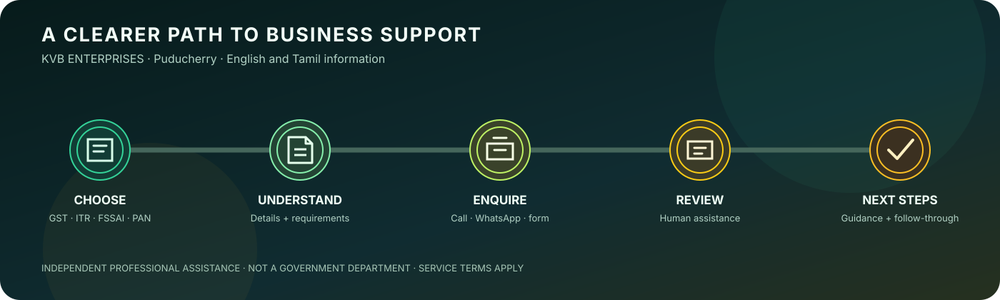

# KVB ENTERPRISES — Business & Tax Services Website

Responsive, multilingual website for **KVB ENTERPRISES**, an independent business and tax-compliance assistance service based in Puducherry. The site presents services, helps visitors understand the enquiry process, and connects them with human assistance.

**Live website:** https://viviberi.github.io/tax-business/

<p align="center">
  
</p>

<p align="center">
  
</p>

<p align="center"><sub>Illustrative enquiry journey. KVB ENTERPRISES is an independent professional assistance service and is not a government department.</sub></p>

## Services presented

The website covers business and compliance assistance including:

- GST registration and filing
- Income tax return assistance
- FSSAI registration and renewal
- MSME registration
- PAN card services
- Trademark assistance
- Business registration and related professional services
- Electrical and HVAC service enquiries

Service availability, eligibility, statutory fees, and professional charges should be confirmed directly with KVB ENTERPRISES before engagement.

## Technology

- HTML, CSS, and JavaScript
- Static-site generation using the Python builder in `_builder/build.py`
- English pages with Tamil-language pages under `ta/`; generated GST location pages link to the Tamil GST services guide without claiming a page-level translation
- GitHub Pages hosting
- Google Analytics 4 event tracking

This is a static website; it is not a WordPress site.

## Repository structure

| Path | Purpose |
|---|---|
| `index.html`, `services/` | Generated home and service pages |
| `ta/` | Tamil-language pages |
| `locations/` | Location-specific pages |
| `tools/` | Website tools |
| `_builder/build.py` | Static-site build script |
| `_builder/prices.json` | Editable service-price configuration |
| `style.css`, `script.js` | Styling, interactions, forms, and analytics events |
| `assets/` | Hand-maintained website assets |
| `privacy.html`, `terms.html` | Privacy and terms pages |
| `sitemap.xml`, `robots.txt` | Search-engine discovery configuration |

Generated pages should be updated through the builder and source configuration rather than edited directly when the builder owns those files. The builder provides equivalent-language links for translated service pages and a clearly labelled Tamil GST guide fallback on English GST location pages.

## Updating displayed prices

1. Edit the relevant value in `_builder/prices.json`.
2. Run the builder from the repository root:

   ```bash
   python3 _builder/build.py
   ```

3. Review the generated changes before committing and publishing.

An empty price value is configured to display **“Get a quote”** rather than a numeric amount.

## Analytics and privacy

The website uses Google Analytics 4 with measurement ID `G-KFP95JFETM`. The README documents these event names:

- `whatsapp_click`
- `call_click`
- `generate_lead`
- `select_service`
- `language_switch`

The current implementation is documented as avoiding transmission of names and phone numbers to Google Analytics. Review the live analytics configuration and privacy notice whenever tracking behavior changes.

## Local development

Clone the repository and run the site builder:

```bash
git clone https://github.com/ViviBeri/tax-business.git
cd tax-business
python3 _builder/build.py
```

Then inspect the generated HTML and assets locally or publish the reviewed changes through the repository's GitHub Pages workflow.

## Important notice

KVB ENTERPRISES is an independent professional assistance service and is **not a government department**. The website does not represent a government portal. Visitors should verify applicable rules, deadlines, statutory fees, and eligibility with the relevant official authority.

## Security

Please report suspected vulnerabilities privately. Read the [Security Policy](SECURITY.md) for the reporting channel, scope, response expectations, and coordinated disclosure process. Do not publish exploit details in a public issue or pull request.

## Contributions and maintenance

When changing the site, preserve the English/Tamil navigation, generated-page workflow, privacy disclosures, accessibility, mobile layout, and working contact links. Language links must point to useful destinations; only declare `hreflang` when the destination is a genuine equivalent page. Verify generated output and test the affected pages before publishing.
