<!-- Raw URL alternative: https://raw.githubusercontent.com/ViviBeri/tax-business/redesign/assets/hero-banner.svg -->

<strong>Clear guidance. Reliable support. Puducherry, India.</strong>

<a href="https://viviberi.github.io/tax-business/">Visit the website</a> · <a href="https://viviberi.github.io/tax-business/ta/">தமிழ்</a>

> **Redesign preview:** `assets/redesign-preview.gif` will be embedded here after the redesign is complete and its 8-second website capture has been reviewed.

## Services

| Service | Description | Turnaround |
|---|---|---|
| GST Registration & Filing | Registration, returns and compliance assistance | Confirmed after document review |
| Income Tax Return Assistance | ITR preparation and filing support | Depends on return complexity |
| FSSAI Registration & Renewal | Food-business licensing and renewal support | Depends on application category |
| MSME / Udyam Registration | Udyam registration and update assistance | Depends on document readiness |
| PAN Card & Trademark Services | PAN application/correction and trademark assistance | Depends on statutory processing |

Processing timelines vary by authority and case. No statutory approval or completion date is guaranteed.

## Why KVB

**Local assistance.** Puducherry-based guidance with English and Tamil support.

**Clear requirements.** Document checklists and service scope explained before proceeding.

**Independent service.** KVB ENTERPRISES is not a government department or government-affiliated service.

## Quick Start

This is a static HTML/CSS/JavaScript site generated by `_builder/build.py`.

1. Clone or download the repository.
2. Run `python3 _builder/build.py` to regenerate English and Tamil output using the existing Python builder.
3. Open `index.html` or `ta/index.html` in a browser; use a local HTTP server if a feature requires module loading.
4. Verify both languages before proposing deployment.

## Tech Stack

**SVG language policy:** README artwork uses English labels and a cross-platform font stack with Tamil fallbacks. The website provides separate English and Tamil HTML content; the SVGs are not translated based on browser language.

## Audit

*The audit badge is a design placeholder, not an independently verified performance or accessibility grade.*

## Contributing and License

Focused pull requests improving accessibility, localization, documentation and performance are welcome.

No repository-wide reuse license is declared here; confirm applicable licensing with the repository owner.

© KVB ENTERPRISES · Puducherry, India <a href="https://viviberi.github.io/tax-business/#contact">Contact KVB ENTERPRISES</a>

